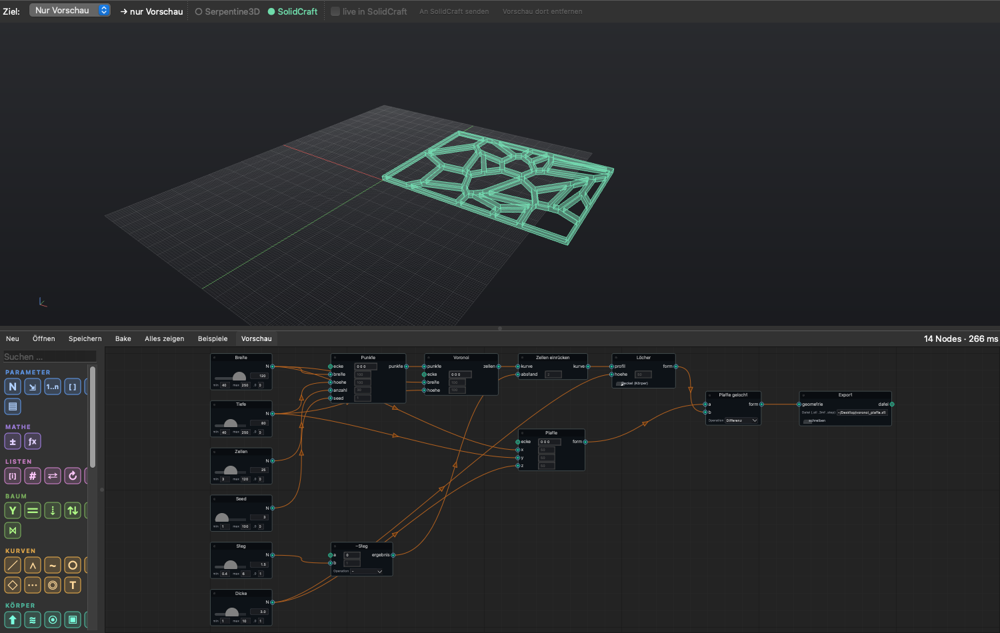
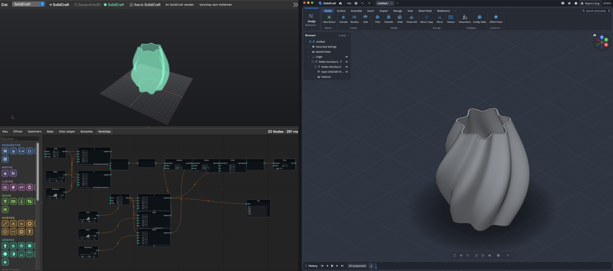

# SolidNode (deutsch)

**Node-basiertes Modellieren für [SolidCraft](https://github.com/tangency-labs/solidcraft)**, ähnlich wie Grasshopper: Regler, Kurven und Körper verbinden, das Ergebnis live sehen und mit einem Klick ins offene SolidCraft-Design legen.





Beim Start prüft SolidNode, ob es auf GitHub eine neuere Version gibt. Wenn ja, erscheint oben ein oranger Knopf **Update auf x.y.z**: ein Klick installiert es und startet neu, der offene Graph kommt mit. Im Terminal geht dasselbe mit `solidnode update`.

Die ausführliche Anleitung steht auf Englisch in der [README](README.md). Die Oberfläche der App ist deutsch.

## Installieren

```bash
# einmal: uv installieren (macOS / Linux)
curl -LsSf https://astral.sh/uv/install.sh | sh

# SolidNode
uv tool install --python 3.12 git+https://github.com/malandereideen/solidnode

# prüfen, was fehlt
solidnode doctor

# starten
solidnode
```

Windows: uv mit `powershell -ExecutionPolicy ByPass -c "irm https://astral.sh/uv/install.ps1 | iex"` installieren, der Rest ist gleich. Aktualisieren mit `uv tool upgrade solidnode`.

## Mit SolidCraft verbinden

SolidCraft muss mit Steuerport laufen. In SolidNode auf **SolidCraft starten** klicken, oder auf dem Mac:

```bash
open -n -a SolidCraft --args --control 7878
```

Der Punkt bei *SolidCraft* oben wird grün, sobald es erreichbar ist.

## Erste Schritte

1. **Beispiele → laser box** öffnen.
2. Regler **Breite** oder **Zinke** ziehen.
3. **Ziel** auf *SolidCraft* (oder *Automatisch*).
4. **An SolidCraft senden**, die Teile liegen als Komponente *Nodes Vorschau* im Design. Mit **live in SolidCraft** wird sie bei jeder Änderung ersetzt.
5. **Bake** legt eine bleibende Kopie ab.

Nodes per Klick oder Ziehen aus der Palette links holen, Ausgänge mit Eingängen verbinden, Werte in die kleinen Felder neben den Eingängen tippen. **Tab** im Feld sucht. Rot = Fehler, gelb = Eingang fehlt, der Tooltip sagt was.

**Geometrie aus SolidCraft holen:** Node *Geometrie holen*, in SolidCraft etwas auswählen (Körper, Fläche, Kante, Skizzenlinie), **Auswahl übernehmen**. Mit **verknüpft** wird es bei Änderungen in SolidCraft neu geholt.

Alle Nodes: [docs/nodes.md](docs/nodes.md). Lizenz: MIT.
