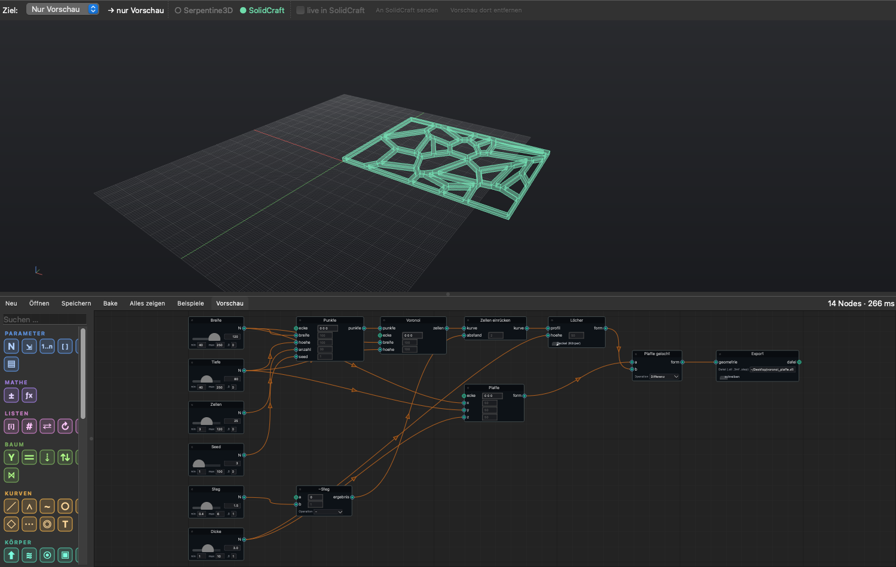
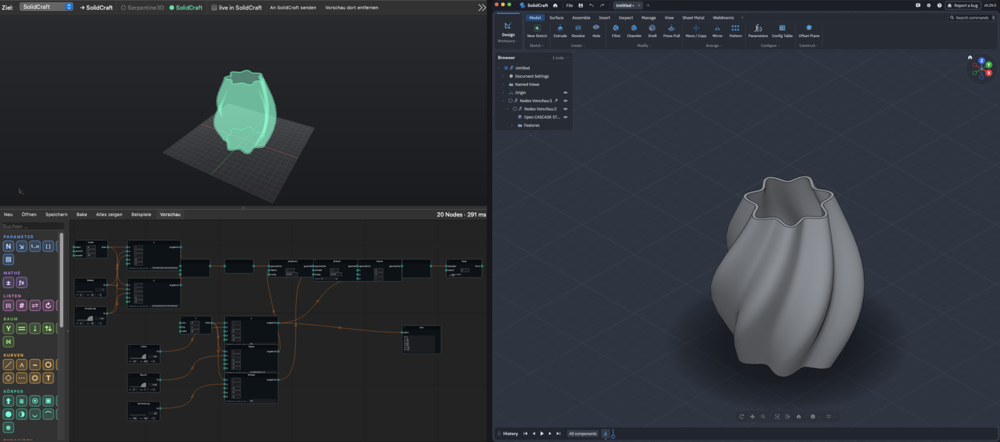
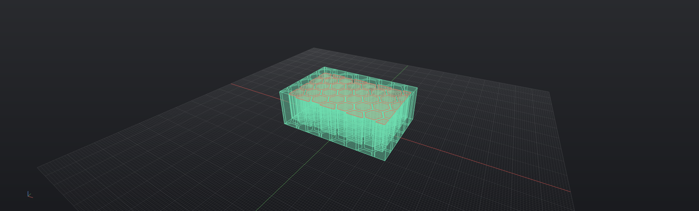
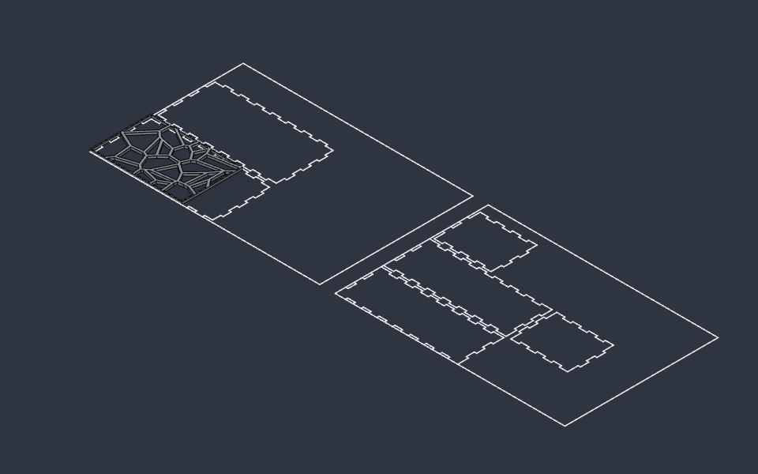
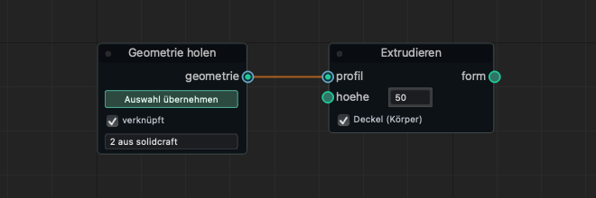
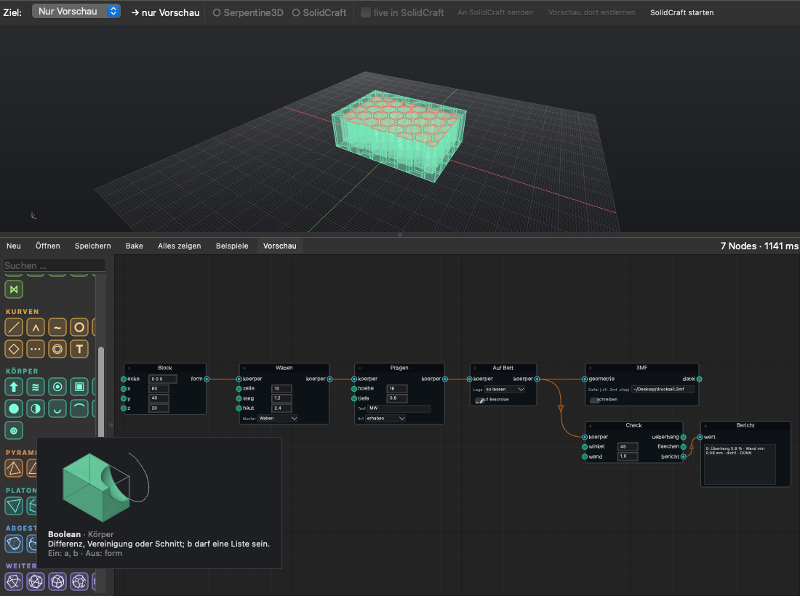
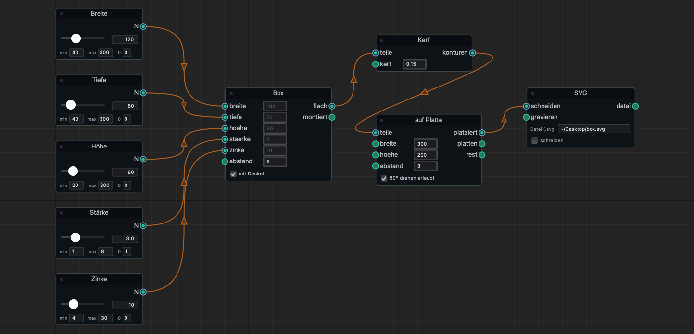

# SolidNode

**Visual, node-based modelling for [SolidCraft](https://github.com/tangency-labs/solidcraft)** — wire sliders, curves and solids together like in Grasshopper, see the result live, and drop it into your open SolidCraft design with one click.



*[Deutsche Kurzfassung](README.de.md)*

---

## What it does

- **Node editor with live preview.** Drag a slider, the geometry updates in ~0.1–0.3 s. Only the nodes downstream of a change are recomputed.
- **Sends to SolidCraft.** Results go into the open SolidCraft design as a component: solids as STEP, meshes as STL, flat curves as a sketch. *Live* mode replaces the preview a second after each change; *Bake* keeps a copy.
- **Picks from SolidCraft.** Select bodies, faces, edges or sketch curves in SolidCraft and pull them into the graph — optionally *linked*, so editing the part in SolidCraft re-runs your graph.
- **Data trees** like Grasshopper: graft, flatten, simplify, flip, branch-wise matching.
- **87 nodes**, including
  - laser cutting: finger-jointed box, living hinge, kerf compensation, nesting, slotted/waffle structures, mm-exact SVG (red = cut, blue = engrave),
  - 3D printing: print check (overhangs shown red), place on bed, clearance pairs, lattice infill, gyroid, threads, embossed text, multi-colour split,
  - all Platonic and Archimedean solids, pyramids, antiprisms,
  - curves, solids, booleans, transforms, Voronoi, expressions.
- **Exact NURBS geometry** (OpenCASCADE), not meshes.


*Left: the vase example in SolidNode. Right: the same vase after* An SolidCraft senden *— a regular solid body in SolidCraft.*

| Laser box: flat, kerf-compensated, nested on two sheets | 3D print part: honeycomb infill, embossed text, overhangs in red |
|---|---|
|  |  |

| Sent into SolidCraft | All 22 polyhedra | Pick geometry from SolidCraft |
|---|---|---|
|  |  |  |

> **Status: early (0.1).** Developed and tested on macOS (Apple Silicon) with SolidCraft 0.29. Linux and Windows should work but are untested — reports welcome. The app's labels are currently **German**; the [glossary](#ui-glossary) below and the [node reference](docs/nodes.md) give the English names.

---

## Install

You need **Python 3.10+** and about **1 GB** of disk for the dependencies (Qt, OpenCASCADE). The easiest way is [uv](https://docs.astral.sh/uv/), which handles Python for you.

**1. Install uv** (once):

```bash
# macOS / Linux
curl -LsSf https://astral.sh/uv/install.sh | sh
```

```powershell
# Windows (PowerShell)
powershell -ExecutionPolicy ByPass -c "irm https://astral.sh/uv/install.ps1 | iex"
```

**2. Install SolidNode:**

```bash
uv tool install --python 3.12 git+https://github.com/malandereideen/solidnode
```

**3. Check everything:**

```bash
solidnode doctor
```

**4. Start:**

```bash
solidnode
```

**Updates:** at start SolidNode checks GitHub. If there is a newer version, an orange **Update auf x.y.z** button appears in the toolbar — one click installs it and offers to restart (your open graph comes along). From the terminal: `solidnode update`. Set `SOLIDNODE_NO_UPDATE_CHECK=1` to switch the check off. (Versions before 0.1.2 have no button yet: run the install command from step 2 again with `--force`.)

Remove with `uv tool uninstall solidnode`.

<details>
<summary>Without uv (pip / pipx)</summary>

```bash
pipx install git+https://github.com/malandereideen/solidnode
# or, in a virtual environment:
python -m pip install git+https://github.com/malandereideen/solidnode
```
</details>

---

## Connect to SolidCraft

SolidNode talks to the **running** SolidCraft app through `solidcraft-cli`, which ships with SolidCraft. SolidCraft has to be started with its **control port** open:

- In SolidNode, click **SolidCraft starten** (shown while SolidCraft isn't reachable), or
- macOS: `open -n -a SolidCraft --args --control 7878`
- Windows / Linux: start the SolidCraft executable with `--control 7878`

The dot next to *SolidCraft* in the toolbar turns green when it's reachable. `solidnode doctor` tells you what is missing.

If `solidcraft-cli` isn't found automatically, point to it:

```bash
export SOLIDNODE_SOLIDCRAFT_CLI=/path/to/solidcraft-cli
export SOLIDNODE_SOLIDCRAFT_PORT=7878   # if you use another port
```

More detail: [docs/solidcraft.md](docs/solidcraft.md).

---

## First steps

1. **Beispiele** (Examples) → *laser box*. The preview shows the flat parts.
2. Drag the **Breite** (width) or **Zinke** (finger width) slider.
3. Set **Ziel** (target) to *SolidCraft* (or leave *Automatisch*).
4. **An SolidCraft senden** — the parts appear in your design as component *Nodes Vorschau*. Tick **live in SolidCraft** to keep it updated.
5. **Bake** puts a permanent copy into the design.





Build your own: hover a tile in the palette on the left to see what the node makes, click it (or drag it into the canvas), connect outputs to inputs, type values into the small fields next to inputs. **Tab** in the canvas searches nodes. Red node = error, yellow = missing input — hover for the message.

### Pick geometry from SolidCraft

Add **Geometrie holen** (Parameter group), select something in SolidCraft, click **Auswahl übernehmen**. Bodies, faces, edges and sketch lines/arcs/circles are supported. A copy is saved in the graph; tick **verknüpft** (linked) to re-read it whenever the SolidCraft design changes.

### Data trees

Each wire carries a tree: branches like `{0;3}`, each holding a list. A node runs branch by branch (the longest list of branches wins) and item by item; list inputs (e.g. *Loft* profiles) get the whole branch. A node that returns a list per item creates sub-branches `{path;i}`. Use **Aufpfropfen** (graft), **Glätten** (flatten), **Vereinfachen** (simplify) and **Matrix tauschen** (flip) to reshape. The *vase_baum* example builds a vase from seven grafted rings.

---

## UI glossary

| German (in the app) | English |
|---|---|
| Ziel: Automatisch / Nur Vorschau | Target: auto / preview only |
| An SolidCraft senden | Send to SolidCraft |
| live in SolidCraft | Live sync |
| Vorschau dort entfernen | Remove preview from SolidCraft |
| SolidCraft starten | Start SolidCraft (with control port) |
| Neu / Öffnen… / Speichern… | New / Open / Save |
| Bake | Bake (permanent copy into the CAD) |
| Alles zeigen | Zoom to all |
| Beispiele | Examples |
| Vorschau | Toggle preview |
| Suchen … | Search nodes |
| Auswahl übernehmen / verknüpft | Take selection / linked |
| Eingang fehlt | Input missing |

All node names in English: [docs/nodes.md](docs/nodes.md).

---

## Optional: Serpentine3D

SolidNode can also drive [Serpentine3D](https://github.com/chisomobanzi/Serpentine3D), an open-source NURBS modeller (it also provides SolidNode's geometry kernel). With the plugin installed, the preview appears live in Serpentine3D's viewport, *Bake* adds objects there, and *Geometrie holen* picks Serpentine3D objects. The plugin has to be installed with **Serpentine3D's** Python:

```bash
/path/to/Serpentine3D/.venv/bin/pip install git+https://github.com/malandereideen/solidnode
/path/to/Serpentine3D/.venv/bin/solidnode install-serpentine-plugin
```

Restart Serpentine3D → menu *Plugins ▸ SolidNode* gives you the editor inside Serpentine3D as well.

---

## Troubleshooting

| Problem | Fix |
|---|---|
| SolidCraft dot stays grey | SolidCraft wasn't started with `--control 7878`. Quit it and use *SolidCraft starten*. |
| `solidcraft-cli` not found | Set `SOLIDNODE_SOLIDCRAFT_CLI` (see above); `solidnode doctor` shows the path it tries. |
| Sending is slow | Large STEP files (e.g. gyroids, many holes) take a second or two; the window waits meanwhile. Use *live* only for light graphs. |
| Print check says *DÜNN* (thin) on text | Its wall measurement reads ~0 at sharp corners such as letter tips — check the part, not the number. |
| A node is red | Hover it: the tooltip has the error. |

---

## How it works

Short version: the graph is computed in Python with OpenCASCADE (through Serpentine3D's geometry module); SolidCraft is driven over its MCP interface (`solidcraft-cli mcp --connect`), exchanging STEP/STL/SVG files through `~/.solidnode/transfer`. Details: [docs/architecture.md](docs/architecture.md).

Run the tests:

```bash
git clone https://github.com/malandereideen/solidnode && cd solidnode
uv venv && uv pip install -e ".[test]"
QT_QPA_PLATFORM=offscreen .venv/bin/pytest
```

---

## Credits & licences

SolidNode is MIT-licensed (see [LICENSE](LICENSE)). It builds on

- [Serpentine3D](https://github.com/chisomobanzi/Serpentine3D) (MIT) — geometry helpers, file export, viewport,
- [NodeGraphQt](https://github.com/jchanvfx/NodeGraphQt) (MIT) — node canvas,
- [OpenCASCADE](https://dev.opencascade.org/) via [cadquery-ocp](https://github.com/CadQuery/ocp-build-system) (LGPL-2.1) and [PySide6 / Qt](https://www.qt.io/qt-for-python) (LGPL-3.0).

Not affiliated with SolidCraft or Serpentine3D. *Grasshopper* is a trademark of Robert McNeel & Associates; SolidNode is an independent project inspired by it.
